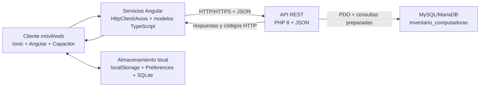

# Arquitectura Cliente - API - Base de datos

## 1. Objetivo

La aplicación móvil **MyFirstAPP** utiliza Ionic, Angular y Capacitor como cliente, una API REST implementada en PHP y MySQL/MariaDB como persistencia principal. El sistema administra usuarios, productos, movimientos de inventario y los indicadores del dashboard.

Este documento describe:

- El flujo entre cliente, API y base de datos.
- Los endpoints requeridos y sus métodos HTTP.
- Los modelos JSON utilizados para el intercambio de información.
- Un servicio Angular tipado para centralizar el consumo de la API.
- La arquitectura propuesta y sus decisiones técnicas.
- La evidencia del análisis y mejora de la arquitectura mediante IA.

> **Estado actual:** `login.php`, `productos.php`, `movimientos.php` y `dashboard.php` ya implementan las operaciones principales. La pantalla de perfil (`src/app/perfil/perfil.page.ts`) actualmente carga y guarda los datos del usuario en `localStorage`, mientras que la fotografía se guarda con Capacitor Preferences. Para que el perfil sea persistente en todos los dispositivos, se propone agregar el endpoint de usuario indicado en este documento.

## 2. Diagrama de arquitectura



### Flujo de una operación

1. El usuario ejecuta una acción en una página Angular.
2. La página delega la operación a un servicio Angular.
3. El servicio envía una solicitud HTTP con un cuerpo JSON, cuando corresponde.
4. La API valida el método, los datos recibidos y las reglas del negocio.
5. PHP consulta o modifica MySQL mediante PDO y sentencias preparadas.
6. La API devuelve JSON y un código HTTP representativo del resultado.
7. Angular actualiza la interfaz y, si el dispositivo está en modo nativo, puede guardar una copia en SQLite para trabajar con caché o sincronización.

## 3. Componentes y responsabilidades

| Componente | Responsabilidad |
|---|---|
| Páginas Angular/Ionic | Presentar formularios, listas y mensajes al usuario. |
| Servicios Angular | Centralizar URLs, tipos, solicitudes HTTP, errores y sincronización. |
| Capacitor | Proporcionar cámara, Preferences y SQLite en Android/iOS. |
| API PHP | Validar entradas, aplicar reglas de negocio y controlar códigos HTTP. |
| `conexion.php` | Crear la conexión PDO y funciones comunes para JSON. |
| MySQL/MariaDB | Persistir usuarios, productos y movimientos. |
| SQLite local | Mantener caché y productos pendientes cuando la aplicación nativa está sin conexión. |

La separación evita que las páginas construyan SQL o conozcan detalles de conexión. El servicio Angular `src/app/services/inventory-api.service.ts` centraliza las solicitudes Axios, valida las respuestas y traduce los errores de la API. También permite cambiar el backend sin modificar la interfaz de usuario.

## 4. Endpoints requeridos

La URL base depende del host configurado en `api.config.ts`. Apache debe utilizar el puerto `8080`; en desarrollo puede utilizarse, por ejemplo, `http://192.168.1.6:8080`.

### 4.1 Autenticación

| Método | Ruta | Uso | Respuestas principales |
|---|---|---|---|
| `POST` | `/login.php` | Iniciar sesión con correo y contraseña. | `200`, `400`, `401`, `403`, `500` |

El endpoint no devuelve el hash de la contraseña. Las consultas usan `password_verify` y PDO con parámetros.

### 4.2 Productos

| Método | Ruta | Uso | Respuestas principales |
|---|---|---|---|
| `GET` | `/api/productos` | Listar productos activos. Admite `?search=texto`. | `200` |
| `GET` | `/api/productos/{id}` | Consultar un producto activo. | `200`, `404` |
| `POST` | `/api/productos` | Crear un producto. Requiere `name`, `code` y `price`. | `201`, `400`, `500` |
| `PUT` | `/api/productos/{id}` | Reemplazar los campos enviados del producto. | `200`, `404` |
| `PATCH` | `/api/productos/{id}` | Actualizar parcialmente un producto. | `200`, `400`, `404` |
| `DELETE` | `/api/productos/{id}` | Borrado lógico: cambia `active` a `0`. | `204`, `404` |

Campos aceptados por la API: `name`, `code`, `price`, `available`, `minimum_stock`, `category`, `brand`, `description` y `active`.

### 4.3 Movimientos de inventario

| Método | Ruta | Uso | Respuestas principales |
|---|---|---|---|
| `GET` | `/api/movimientos` | Listar los últimos 100 movimientos con nombre del producto. | `200` |
| `GET` | `/api/movimientos/{id}` | Consultar un movimiento. | `200`, `404` |
| `POST` | `/api/movimientos` | Registrar una entrada o salida y actualizar existencias. | `201`, `400`, `409` |
| `PUT` o `PATCH` | `/api/movimientos/{id}` | Editar un movimiento y recalcular existencias. | `200`, `400`, `404`, `409` |
| `DELETE` | `/api/movimientos/{id}` | Eliminar el movimiento y revertir su efecto en existencias. | `204`, `404`, `409` |

Las operaciones de escritura de movimientos se ejecutan dentro de una transacción para que el inventario y su historial no queden desincronizados.

### 4.4 Dashboard

| Método | Ruta | Uso | Respuestas principales |
|---|---|---|---|
| `GET` | `/api/dashboard` | Obtener totales de inventario y movimientos recientes. | `200`, `500` |

### 4.5 Perfil de usuario (endpoint recomendado)

La pantalla de perfil necesita un endpoint para dejar de depender únicamente de `localStorage`.

| Método | Ruta | Uso | Respuestas principales |
|---|---|---|---|
| `GET` | `/api/usuarios/{id}` | Consultar el perfil sin devolver `password`. | `200`, `404` |
| `PATCH` | `/api/usuarios/{id}` | Actualizar `name`, `email` o `role` después de validar permisos. | `200`, `400`, `403`, `404`, `409` |

La fotografía no debe enviarse como una cadena Base64 en cada consulta si el sistema crecerá. Se recomienda un endpoint separado `POST /api/usuarios/{id}/foto` usando `multipart/form-data`, o un almacenamiento de archivos/objeto con una URL persistida en la tabla `users`.

## 5. Métodos HTTP y convenciones

- `GET`: lectura; no debe modificar datos.
- `POST`: creación o ejecución de una operación nueva.
- `PUT`: actualización completa o reemplazo del recurso.
- `PATCH`: actualización parcial.
- `DELETE`: eliminación lógica o física según la regla del recurso.
- `OPTIONS`: respuesta de preflight CORS.

La API debe mantener estas convenciones:

- `200 OK`: lectura o actualización exitosa.
- `201 Created`: recurso creado.
- `204 No Content`: operación exitosa sin cuerpo de respuesta.
- `400 Bad Request`: JSON inválido o datos incompletos.
- `401 Unauthorized`: credenciales inválidas.
- `403 Forbidden`: usuario sin permiso o cuenta inactiva.
- `404 Not Found`: recurso inexistente.
- `409 Conflict`: conflicto de inventario o regla de negocio.
- `500 Internal Server Error`: error inesperado del servidor.

Las respuestas de error deben conservar un formato consistente:

```json
{
  "error": "Descripción segura para el cliente"
}
```

## 6. Modelos JSON de intercambio

### 6.1 Login

Solicitud:

```json
{
  "email": "admin@example.com",
  "password": "Admin123!"
}
```

Respuesta `200`:

```json
{
  "success": true,
  "message": "Login exitoso.",
  "user": {
    "id": 1,
    "name": "Administrador",
    "email": "admin@example.com",
    "role": "admin"
  }
}
```

### 6.2 Producto

Solicitud `POST`:

```json
{
  "name": "Teclado mecánico RGB",
  "code": "TEC-RGB-001",
  "price": 899.00,
  "available": 25,
  "minimum_stock": 10,
  "category": "Periféricos",
  "brand": "Redragon",
  "description": "Teclado mecánico con iluminación RGB.",
  "active": 1
}
```

Respuesta de listado `GET`:

```json
{
  "success": true,
  "message": "Productos cargados correctamente.",
  "data": [
    {
      "id": 1,
      "name": "Teclado mecánico RGB",
      "code": "TEC-RGB-001",
      "price": "899.00",
      "available": 25,
      "minimum_stock": 10,
      "category": "Periféricos",
      "brand": "Redragon",
      "description": "Teclado mecánico con iluminación RGB.",
      "active": 1,
      "created_at": "2026-09-16 10:00:00",
      "updated_at": "2026-09-16 10:00:00"
    }
  ]
}
```

En TypeScript, `price` debe normalizarse con `Number(...)` porque MySQL puede serializar `DECIMAL` como cadena.

### 6.3 Movimiento

Solicitud:

```json
{
  "product_id": 1,
  "type": "Salida",
  "quantity": 2,
  "notes": "Venta mostrador"
}
```

Respuesta `201`:

```json
{
  "id": 13,
  "message": "Movimiento registrado"
}
```

### 6.4 Dashboard

Respuesta:

```json
{
  "success": true,
  "message": "Dashboard cargado correctamente.",
  "data": {
    "totalProducts": 10,
    "lowStock": 4,
    "outOfStock": 2,
    "healthyPercentage": 80,
    "recentMovements": [
      {
        "id": 12,
        "productId": 9,
        "product": "Adaptador USB-C",
        "type": "Entrada",
        "quantity": 10,
        "date": "2026-10-10T18:30:00Z",
        "icon": "barcode-outline"
      }
    ],
    "updatedAt": "2026-10-10T19:00:00-06:00"
  }
}
```

### 6.5 Perfil

Solicitud `PATCH` propuesta:

```json
{
  "name": "Gamaliel Acosta",
  "email": "gama.acosta@gmail.com",
  "role": "admin"
}
```

Respuesta propuesta:

```json
{
  "success": true,
  "message": "Perfil actualizado correctamente.",
  "user": {
    "id": 1,
    "name": "Gamaliel Acosta",
    "username": "gama7894",
    "email": "gama.acosta@gmail.com",
    "role": "admin"
  }
}
```

## 7. Servicio Angular preparado para consumir la API

El proyecto ya centraliza los hosts en `src/app/config/api.config.ts` y usa Axios en varias páginas. Para evitar que cada página repita URLs, tipos y manejo de errores, se propone un servicio dedicado. El siguiente código puede guardarse como `src/app/services/inventory-api.service.ts`.

```typescript
import { Injectable } from '@angular/core';
import axios, { AxiosRequestConfig } from 'axios';
import { API_ENDPOINTS } from '../config/api.config';

export interface ApiUser {
  id: number | string;
  name: string;
  username?: string;
  email: string;
  role: string;
}

export interface ApiProduct {
  id: number;
  name: string;
  code: string;
  price: number;
  available: number;
  minimum_stock?: number;
  category?: string | null;
  brand?: string | null;
  description?: string | null;
  active?: number;
}

export interface ApiMovement {
  id?: number;
  product_id?: number;
  product: string;
  type: 'Entrada' | 'Salida';
  quantity: number;
  notes?: string | null;
  date?: string;
  icon?: string;
}

export interface DashboardData {
  totalProducts: number;
  lowStock: number;
  outOfStock: number;
  healthyPercentage: number;
  recentMovements: ApiMovement[];
  updatedAt: string;
}

interface CollectionResponse<T> {
  success: boolean;
  message?: string;
  data: T;
}

@Injectable({ providedIn: 'root' })
export class InventoryApiService {
  private readonly requestConfig: AxiosRequestConfig = { timeout: 10000 };

  async login(email: string, password: string): Promise<ApiUser> {
    const response = await axios.post<{ success: boolean; user: ApiUser }>(
      API_ENDPOINTS.login,
      { email, password },
      this.requestConfig,
    );
    return response.data.user;
  }

  async getProducts(search = ''): Promise<ApiProduct[]> {
    const response = await axios.get<CollectionResponse<ApiProduct[]>>(
      API_ENDPOINTS.productos,
      { ...this.requestConfig, params: search ? { search } : undefined },
    );
    return response.data.data.map((product) => ({
      ...product,
      id: Number(product.id),
      price: Number(product.price),
      available: Number(product.available),
    }));
  }

  async createProduct(product: Omit<ApiProduct, 'id'>): Promise<ApiProduct> {
    const response = await axios.post<ApiProduct>(
      API_ENDPOINTS.productos,
      product,
      this.requestConfig,
    );
    return response.data;
  }

  async deleteProduct(id: number): Promise<void> {
    await axios.delete(`${API_ENDPOINTS.productos}/${id}`, this.requestConfig);
  }

  async getDashboard(): Promise<DashboardData> {
    const response = await axios.get<{ data: DashboardData }>(
      API_ENDPOINTS.dashboard,
      this.requestConfig,
    );
    return response.data.data;
  }

  async createMovement(input: {
    product_id: number;
    type: 'Entrada' | 'Salida';
    quantity: number;
    notes?: string;
  }): Promise<{ id: number; message: string }> {
    const response = await axios.post<{ id: number; message: string }>(
      API_ENDPOINTS.movimientos,
      input,
      this.requestConfig,
    );
    return response.data;
  }
}
```

### Uso desde una página

```typescript
constructor(private readonly inventoryApi: InventoryApiService) {}

async loadProducts(): Promise<void> {
  try {
    this.products = await this.inventoryApi.getProducts(this.searchTerm);
  } catch (error: unknown) {
    this.errorMessage = 'No se pudieron cargar los productos.';
    console.error('Error al consultar productos:', error);
  }
}
```

Para producción, el servicio debe añadir autenticación basada en token, un interceptor para adjuntar `Authorization: Bearer <token>` y una estrategia de renovación o cierre de sesión cuando la API responda `401`. El endpoint de login actual no genera token, por lo que esa parte requiere una evolución coordinada del backend.

## 8. Persistencia local, caché y sincronización

La arquitectura utiliza tres tipos de almacenamiento con responsabilidades distintas:

1. **`localStorage`:** sesión y datos básicos actualmente usados por la pantalla de perfil.
2. **Capacitor Preferences:** fotografía de perfil en el dispositivo.
3. **SQLite:** caché de productos, dashboard y productos pendientes en la aplicación nativa.

La API sigue siendo la fuente de verdad. SQLite sirve para mostrar datos recientes sin conexión y para guardar operaciones pendientes. Cuando vuelve la conectividad, `ProductSyncService` envía los productos pendientes a `POST /api/productos` y reemplaza el registro local con la respuesta del servidor.

La fotografía guardada como Data URL en Preferences es adecuada para un prototipo, pero debe migrarse a almacenamiento de archivos y a una URL remota si se requiere compartirla entre varios dispositivos.

## 9. Seguridad y confiabilidad

- Cambiar `http://` por `https://` fuera del entorno local.
- Restringir `Access-Control-Allow-Origin`; no usar `*` en producción.
- No guardar contraseñas ni hashes en el cliente.
- Aplicar autorización por rol en cada endpoint de escritura, no solamente en la interfaz.
- Mantener consultas preparadas y validación de tipos en PHP.
- No devolver mensajes internos de excepciones al usuario final; registrar el detalle en el servidor.
- Validar que `PATCH` y `PUT` no permitan modificar campos que el rol actual no puede cambiar.
- Mantener transacciones para movimientos de inventario y verificar stock antes de confirmar.
- Añadir paginación a productos y movimientos cuando el volumen crezca.
- Usar un identificador de correlación y logs del servidor para diagnosticar errores.

## 10. Evidencia de uso de IA

La arquitectura fue analizada y mejorada con asistencia de IA a partir de la inspección del código fuente del proyecto. La evidencia técnica utilizada fue:

| Evidencia observada | Decisión o mejora derivada |
|---|---|
| `api/index.php` enruta `productos`, `movimientos` y `dashboard`. | Se documentó una API REST por recursos y se conservaron sus rutas existentes. |
| `conexion.php` usa PDO, `utf8mb4` y consultas preparadas. | Se mantuvo el acceso parametrizado y se recomendó no exponer errores internos. |
| `movimientos.php` usa transacciones para modificar stock e historial. | Se documentó `409 Conflict` para stock insuficiente y se recomendó conservar la atomicidad. |
| `api.config.ts` construye las URLs desde un host configurable. | El servicio Angular reutiliza `API_ENDPOINTS` en lugar de duplicar URLs. |
| `product-sync.service.ts` sincroniza pendientes cuando vuelve la conexión. | Se incluyó SQLite como caché local y la API como fuente de verdad. |
| `perfil.page.ts` usa `localStorage` y Preferences, pero no llama a la API. | Se identificó la brecha y se propusieron `GET/PATCH /api/usuarios/{id}`. |
| MySQL define `users`, `productos` y `movimientos` con claves y restricciones. | Los modelos JSON y endpoints se alinearon con esas entidades y relaciones. |
| MySQL puede devolver `DECIMAL` como texto en JSON. | El servicio normaliza `price` con `Number(...)`. |

Ejemplo de instrucción de análisis empleada:

> “Analiza la API PHP, el esquema MySQL y el cliente Ionic/Angular. Propón un diagrama Cliente → API → Base de datos, documenta endpoints y métodos HTTP, define los JSON de entrada/salida y prepara un servicio Angular tipado. Señala diferencias entre el comportamiento actual y el diseño recomendado.”

La IA se utilizó como apoyo para localizar dependencias, comparar capas y detectar inconsistencias; las decisiones finales se verificaron contra los archivos reales del proyecto. No se consideró la recomendación de IA como sustituto de las pruebas de compilación, integración y seguridad.

## 11. Conclusión

La solución propuesta conserva las rutas actuales y establece una separación clara entre presentación, servicios, API y persistencia. El siguiente paso prioritario es implementar el módulo de usuarios en PHP y conectar `PerfilPage` con `InventoryApiService`; después deben añadirse autenticación por token y autorización por rol para que los datos del perfil y las operaciones de inventario sean seguros y consistentes entre dispositivos.
